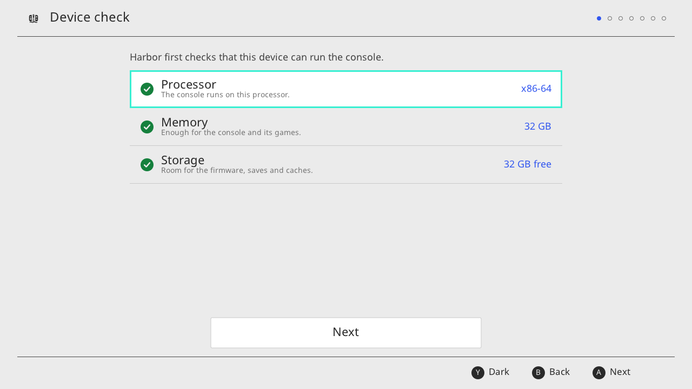
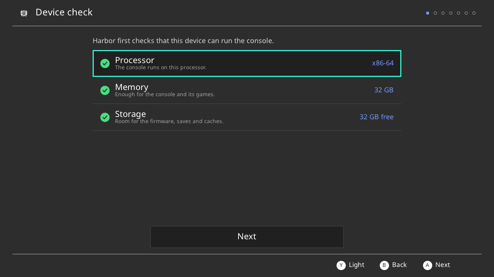

# Harbor on Eden — port plan (phase 0)

2026-10-06. Status: **phase 0 complete; tobagin gave the go-ahead for phase 1.** No emulator code has
been written yet. This repository is upstream Eden `10bcd2d84` (2026-10-05) on branch `harbor`, with
this plan added. The remote is `github.com/openpak/harbor` (private). Pushing to upstream Eden is
disabled, and nothing is ever sent upstream.

Detailed evidence, one file per area. Every row of the summaries below comes from these:

| Area | File |
|---|---|
| Core: kernel, am/applets, hid, vi, fs/ns launch, audio, command ledger | [eden-port/core.md](eden-port/core.md) |
| OpenPak services: accounts, network/TLS/DNS, social, news/pctl, eShop/system, fork verdict, openpak-client | [eden-port/services.md](eden-port/services.md) |
| Host: Android/Qt frontends, console mode, wizard hand-off, controllers, build, identity | [eden-port/host.md](eden-port/host.md) |
| Wizard toolkit: Borealis evaluation and Device-check proof of concept | [eden-port/borealis.md](eden-port/borealis.md) |

An independent review checked the plan against the code before the gate. Every Eden-side claim it
spot-checked held at the cited lines; its structural findings are folded into this version.

## 1. Decision and why

Harbor (OpenPak's Switch console emulator, AGPL-3.0-only) moves from its modified Ryujinx base
(`emulators/ryujinx-android`, `feature/android-port`) onto Eden. It keeps everything Harbor does:
the real firmware 23.0.1 boots as a console (qlaunch, overlayDisp, starter, library applets as guest
processes), with all network traffic going to OpenPak. Desktop (Linux first) and Android.

**Speed.** tobagin compared both on the ROG Phone 3 and found Eden much faster than the Ryujinx
Harbor. That settles the question; no matched benchmark run was needed.

The Ryujinx Harbor stays the reference and keeps working until the Eden Harbor passes the parity
checklist (phase 5).

## 2. What phase 0 found

**Eden already has the architecture Harbor had to build.** qlaunch, overlayDisp, the starter and
library applets already run in Eden as real guest processes, each with its own page table. Eden also
already has:
- application launch from HOME (`IApplicationCreator` 0/10);
- winding;
- an N-layer z-sorted compositor with blending;
- system buffer sharing from the secure pool;
- per-aruid HID shared memory;
- a process-exit observer;
- much of the firmware 23 surface.

Eden's commit messages (`5d150cac5`, `bfba95fd6`, `54cd5fb8e`, `86eae5cc4`) describe qlaunch on
firmware 23 launching games on desktop and Android; nobody has run that here yet (phase 1 gate does).
So the core port is mostly **behaviour deltas**, not new subsystems.

**The one architectural difference.** Harbor's `AppletManager.cs` is imperative: it queues explicit
messages, and each hard-won behaviour is a special case. Eden's am recomputes every applet's state from
the applet tree on each event (`WindowSystem::UpdateAppletStateLocked`, `LifecycleManager`) and derives
the messages from that state. Harbor's fixes therefore get **re-expressed as state rules**, not copied.

**Where Eden is behind Harbor** (each is in a map with file:line references):

| Gap | Effect if not fixed |
|---|---|
| The starter gets `FocusStateChanged`, because Eden treats it as an application | setup stalls at the parental-controls hand-offs |
| No hold on qlaunch's `ChangeIntoForeground` until it has released the library applet's accessor | qlaunch deadlocks (the eShop freeze) |
| A caller behind a full-screen applet still gets input; disabled npads freeze on their last state; no held-button mask | the Outbound name-entry bug class |
| HOME presses also go to the application; the power and capture handlers are empty | HOME and power behave unlike a console |
| audren stops at REV15 | the 23.0.1 starter dies with 2153-0002 |
| First boot skips setup: EULA pre-accepted, initial-launch flags 0x10001, an automatic "Eden" user, host region overwrite, user ASSERTs | the starter never runs |
| Applet program ids predate firmware 22; seven applets default to host (HLE) UI | web, shop, login and swkbd are not the firmware's own |
| No sm service access lists | MyPage dies (2121-0090); setup hides three pages |
| fsp 210: Eden maps it to SetCurrentProcess; Harbor's reading (OpenDataStorageByCurrentProcess) comes from the 23.0.1 fs-client vtable | firmware-23 applets may not mount their RomFs |
| All fbshare sessions render into the same two slots (guess) | wrong frames during setup |
| ovln is broken (wrong layouts, senders never reach receivers, empty receive returns `ResultUnknown`) | overlayDisp aborts; no overlay pop-up |
| News invents its own content and downloads from Eden's servers | a host substitute, and non-OpenPak traffic |
| Upstream disables TLS verification; there is no DNS redirection and no 23.x resolver 100/102/104 | safety, and every online feature |
| One 128-entry bsd fd table shared by every process | sockets collide or run out once several firmware processes are online (guess) |
| The pctl host PIN applet accepts any PIN | parental controls bypassed |

**Command coverage.** Harbor added 687 IPC command ids on top of Ryujinx. Eden has a handler for
450 of them (some are stubs) and lacks 237: 122 in core, 115 in services. The lists per interface are
in [core.md appendix A](eden-port/core.md#appendix-a-command-ids-harbor-added-that-eden-lacks-nullptr-or-absent-by-interface).

**The old OpenPak Eden fork** (`emulators/eden`, 135 commits) is **not** the base:
- More than half of it is host UI that Harbor's model gives to the firmware (OpenPak windows, toasts,
  a replacement MyPage, invitation dialogs).
- Its identity model ties OpenPak to the host's selected profile, not to users created by firmware
  setup.

Instead, cherry-pick about 25 of its commits onto upstream and rewrite about 10 from their
descriptions. The list is in [services.md §1](eden-port/services.md#1-verdict-on-the-old-openpak-eden-fork).
A trial gave 22 clean picks and 16 conflicts against pristine `10bcd2d84`; resolving them is about
3.5–4 days. The clean, untainted picks land in phase 1, before phase 2 rewrites the files around them.

**Socket code must be rewritten clean-room.** Six fork commits (`73da2f25b7`, `497320b975`,
`fd1b755fc4`, `03d14d62d1`, `fa69cbe39f`, `fb99c24f47`) and two Harbor commits (`3ab97fbe7`,
`081d5cd88`) descend from the an earlier Ryujinx fork poll code (source-available) that Ryujinx master
removed in `154744710`. Whoever does that rewrite must not have read those diffs.

**openpak-client**: reuse its core library only (ceiling, profile, CA, friends REST, Penne push,
BCAT, the dauth/BaaS chain), never its Qt half. It needs 4–6 days of changes:
- one session per firmware user;
- the Nintendo Account OAuth exchange and edge tokens;
- async calls;
- a push hook for ovln and pctl;
- a privacy scrub;
- a secret-store hook.

## 3. Wizard: Borealis passes

**Verdict: Borealis, XITRIX fork, vendored at a pinned commit.** It is the one setup wizard for
desktop, Android and later iOS, as tobagin asked. It is the only maintained fork on SDL3, Eden's SDL,
and it has a shipped Android APK and iOS path (Moonlight-Switch).

**Proof of concept** (the Device check page, `research/borealis/poc`; a standalone app with its own
SDL3):

| | Desktop (Linux) | ROG Phone 3 (Android 12, Adreno 650, stock driver) |
|---|---|---|
| Runs | yes | yes (r2; r1 crashed on a missing icon font, fixed) |
| First frame | 0.68–0.99 s after `main` | activity 150–314 ms; first frame about 0.55 s after `main` |
| Rendering | GL, 1280×720 canvas scaled uniformly | GLES 3.2, full-screen landscape 2340×1080, no system bars |
| Real check values | processor, memory, storage (+ Vulkan with `--vulkan`) | all six: 64-bit ARM, 12 GB, Vulkan 1.1 Adreno 650, Turnip-capable, Android 12, 255 GB free |
| Light / charcoal dark themes | yes, live switch | yes, live switch by touch |
| Keyboard / D-pad | arrows, A/B/X/Y semantics | D-pad moves focus |
| Touch | not exercised | taps on the hint bar and Next work (a real-length press; adb's zero-length tap is ignored) |
| Physical controller | not run (by code: by-position A right, B bottom, X top, Y left) | **not tested** — no pad connected |
| APK | — | 6.2 MB (2.3 MB compressed), minSdk 29, 16 KiB aligned |

**Conditions:**
- Never ship Borealis' bundled fonts and images (Nintendo system fonts, Pokémon art). Use Noto Sans
  (OFL) and Material Icons (Apache-2.0).
- Use exactly Eden's SDL3 version.
- One wizard run per process.
- Carry three small patches: uniform canvas fit, a focus route to the central action, and the Android
  `PLATFORM_ANDROID` define.
- Drop the CJK fallback font load, which reads a tens-of-MB file.

**Integration:**
- **Android, option A:** Borealis is built into `libyuzu-android.so`, so there is one SDL copy.
  `HarborSetupActivity extends SDLActivity`. On Ready it writes `harbor-setup.json` and starts the
  console activity.
- **Android, option B (written fallback):** the wizard in its own `:setup` process with its own SDL
  built from Eden's version; installs go to the main process through a bound service. Costs about
  6 MB and some IPC glue.
- **Desktop:** the wizard runs inside the Harbor executable before `QApplication`, then hands over to
  Qt.

**Still open (first tasks of the wizard stream in phase 4):**
- Option A is untested: the proof of concept was standalone. The first task is to run it inside
  Eden's APK and check that SDL's activity teardown leaves Eden's SDL3 audio working. If it fails,
  option B.
- Folder picks on Android: `SDL_ShowOpenFolderDialog` is unsupported there, so the games/DLC/updates
  pages need a small JNI `ACTION_OPEN_DOCUMENT_TREE` bridge. Decision: SAF tree URIs, which Eden's
  core already reads; no all-files permission.
- One session with a physical controller (Kunai or Pro).

**Effort:** 21–31 days, against 23–34 for twin Kotlin + Qt wizards. iOS later adds 3–5 days, against
7–10 for a third native wizard.

## 4. Feature map summary

Effort is engineer-days for someone who knows the code (H/M/L = confidence). Verdicts: **reuse**
Eden, **port** Harbor's logic to C++, **rewrite** from a behaviour description.

### Core — [core.md](eden-port/core.md)

| Area | Eden today | Verdict | Effort |
|---|---|---|---|
| Multi-process, memory pools, secure-pool framebuffers, fw22/23 kernel quirks | has | reuse | 1 (H), verification |
| Guest thread dump (F12) and svcBreak/IPC failure logging | partial | port, **first** | 1 (H) |
| HOME-session mode: no default user, starter runs, overlay on, all applets LLE, 22.x program-id table | partial | port | 1.5 (H) |
| Starter Foreground/Background messages; ASSERTs → result codes | missing | port as state rule | 1 (H) |
| Held `ChangeIntoForeground` until accessor release | missing | port as state rule | 1.5–2 (M) |
| Library-applet accessor and self-accessor, application accessor, overlay, global-state commands | partial | port | 4–5 (M) |
| Partial-foreground drawing over the caller | has (implicit) | reuse + explicit z | 0.5 (M) |
| HOME short/long, power middle press, capture routing | partial | port Harbor's rules | 1.5–2 (M) |
| Reboot/shutdown relaunch | partial | port flag (frontend relaunches) | 0.5 (H) |
| HID: input only for the focus chain, neutral entries, held mask, inline-helper sharing | partial | port into hid_core + am | 3–4 (M) |
| vi: per-session fbshare slots (≥3 sessions), capture commands | partial | port | 1.5 (M) |
| audren REV16–18 acceptance; mute the suspended title | missing | port | 1.5 (H/M) |
| fsp 210/212 (adopt Harbor's reading, verify on overlayDisp's RomFs mount), fsp 21; sm access lists | conflict / missing | port | 2.5–3 (M) |
| ns launch-path commands, lbl, btm, ldn, nfc, caps:a sweep | partial | port per service | 5 (M) |
| Applet speed on the phone (creation → first frame for NetConnect/PlayerSelect) | unmeasured | measure, then tune | 2–3 (L) |
| **Core total** | | | **gate 18–24; full parity 35–45** |

### OpenPak services — [services.md](eden-port/services.md)

| Area | Eden today | Verdict | Effort |
|---|---|---|---|
| Console-mode accounts (one ProfileManager, zero users safe, acc:su 200/201/206) | missing | rewrite boot path + port | 2–3 (M) |
| NA registration/linking: acc:su 211–214/230, IOAuthProcedure, NA OAuth against nx-baas, dauth/edge tokens | missing | port + openpak-client | 9–12 (M-L) |
| IAdministrator 250–252 (290 needs RE), IManagerFor* 120/136/143, id_token cache, ns 2366/4105 | partial | port + fork picks | 6–9 (M) |
| Boot connection: site check, ceiling + profile fetch, pinned CA, `server.json`, 6 h refresh | missing | openpak-client + port of `OpenPakHostSetup` | 2.5–3 (H) |
| TLS: always verify, OpenPak CA, cert 1033 / 0xFFFFFFFE, Peek/DoNotClose/ALPN | partial (unsafe) | fork picks re-expressed | 2–3 (M) |
| DNS: sfdnsres/nsd redirect, fail-closed families, fw23 resolver 16/100/102/104 | missing | fork picks + port | 3–4 (M-L) |
| nifm (the rest after the phase-2 wired stub), ldn fixes | partial | fork picks + port | 1.5 (M) |
| bsd clean-room rewrite, per-process fd tables | partial | **rewrite clean-room** | 6–10 (L-M) |
| friends (≈107 commands), presence, invitations + IApplicationAccessor 180 | partial | fork `ddbcea330f` + port | 5–6 (M-H) |
| Penne push, npns, notif | missing / partial | openpak-client + port | 2 (H) |
| OvlnAgent (the rest after the phase-2 receiver) + FriendsOverlayNotifier | broken | port Harbor + tests | 3 (M) |
| News: delete Eden's built-in news; port NewsStore/Query/DownloadContext; title BCAT | conflicting | port + fork picks | 7–9 (M) |
| pctl: moon pairing, setting sync, PIN/rating/play timer, push, overlays; remove host PIN applet | missing | port, from **golden traces** | 13–16 (M) |
| eShop: firmware web program (1042/1043/100F), nim:shp, ns:ec/VGC/rights, ns unknown-contract set | partial / wrong | port | 5–6 (M) + systemWeb bring-up 3–10 (L) |
| set:sys persistence (after the phase-2 first-boot fixes), erpt, notif, prepo, olsc, caps notify, fatal → crash report | partial | port | 4–5 (M) |
| Fork conflict resolution; openpak-client changes | — | — | 7.5–10 (M) |
| **Services total** | | | **≈ 80–105 (services.md de-duplicates to 85–110), + 9.5–21 low confidence** |

### Host — [host.md](eden-port/host.md)

| Area | Eden today | Verdict | Effort |
|---|---|---|---|
| Console mode: readiness gate → wizard or qlaunch, hidden library scan, console preset, stopped screen; Android + Qt | partial (qlaunch button / `-qlaunch`) | rewire | 8 (M) |
| Wizard pages: keys, firmware 23.0.1 (moved into `frontend_common`), folders, driver, device check | partial pieces | Borealis (§3) | 21–31 (M) |
| GPU drivers: adrenotools loader/store reused; Harbor's catalogue (4 sources, SHA-256, minApi, family filter) | partial | port into fetcher | 4 (M) |
| Touch overlay (yuzu lineage), hide while a pad is connected, FPS overlay | has | reuse, Harbor art later | 0.5–1 (H) |
| Controllers: by-position mapping, Kunai/ASUS, auto-bind the first pad, Joy-Con detach, Plus+Minus menu, host-panel navigation | partial | port policy | 7–9 (M) |
| Desktop mouse: mouse → console touch, focus loss releases held input | partial (Qt mouse-as-touch) | verify + port | 0.5–1 (M) |
| Harbor menu (Resume, Joy-Con, Restart, Driver, FPS, Log threads, Set up again) | partial | rewrite contents | 2 (M) |
| Desktop F-keys (F6 dock, F7 Joy-Con, F8 HOME short/long, F11 fullscreen, F12 dump), remapping Eden's clashing defaults | partial | rebind | 2.5 (M) |
| Audio (cubeb/SDL3), signal chaining, SAF file access | has | reuse, validate | 1.5 (M) |
| Keystore / libsecret secret store | missing | port | 3 (M) |
| Identity `org.openpak.harbor`, icon, strings, desktop `harbor` binary and data dir | missing | rewrite | 2.5 (H) |
| **Host total** | | | **30–41 + wizard 21–31** |

### Overall

About **170–230 engineer-days**, plus 10–21 low-confidence days: systemWeb bring-up, play-timer
enforcement, IAdministrator 290. Most of it splits into independent per-service and per-file streams,
so the calendar time depends on how many streams run at once. The serial spine is am core →
accounts → friends/pctl.

## 5. Decisions taken in phase 0 (tobagin can overturn any)

1. **Base:** fresh upstream `10bcd2d84`, plus the fork's carry list. Rebase onto newer upstream only
   at planned points, never in the middle of a phase. Harbor's changes sit behind a HOME-session
   policy and in a few bounded files, to keep rebases cheap.
2. **Android flavours:** ship both **legacy** (minSdk 29, needed for the ROG Phone 3 on API 31) and
   **mainline** (API 33+). This is tobagin's decision. Delete `genshinSpoof` (it impersonates another
   app's package) and `chromeOS`.
3. **Package id during the port:** `org.openpak.harbor.eden`, so it installs beside the current
   Harbor. The Kotlin namespace stays `org.yuzu.yuzu_emu` (JNI symbols depend on it). At cut-over the
   id becomes `org.openpak.harbor`, signed with a **new release key kept outside the repository** (the
   current Harbor APK is signed with a debug key, which a release must not inherit).
4. **No data migration** from the Ryujinx Harbor. The network is alpha, and the layouts differ (`bis/`
   vs `nand/`). Because the new key cannot update the old APK, cut-over means **uninstalling the
   phone's Harbor, losing its linked profile and saves** unless they are exported first. So at
   cut-over: export saves, or keep the Ryujinx Harbor installed beside the Eden Harbor until tobagin
   says otherwise. The owner reruns the firmware setup.
5. **TLS:** Harbor's model. Always verify, accept the pinned OpenPak CA, and never excuse a name
   mismatch. Upstream's verify-off is removed.
6. **DNS:** fail closed for every ceiling family while OpenPak is on (ban risk 2181-4008).
7. **Data files:** Harbor's names inside openpak-client (`openpak/server.json`, `ca.pem`,
   `network-profile.json`, `network-ceiling*`). Secrets go through the host secret store, never as
   plain JSON. Android `allowBackup` is off.
8. **No host substitutes and no third-party services** in console mode: no Android keyboard or web
   host applets, no host PIN applet, no built-in news, no Eden updater, no web service/rooms, no
   Discord presence, no multiplayer lobby, no game list, no `REQUEST_INSTALL_PACKAGES`.
9. **Game patches:** only the existing sanctioned exception, the Crash Team Racing key-swap IPS.
   Nothing else.
10. **Saves:** Save Data Cloud goes through the firmware's own olsc path (the console protocol), as a
    later phase-3 stream after accounts. No host cloud-save feature (the fork's `save_sync` is
    dropped; Harbor's `SaveArchive` was never on the HOME launch path).
11. **Crash reports:** erpt accepts and discards the firmware's reports, as on Harbor. Harbor's
    consent-gated fatal → OpenPak crash report is ported in phase 3 (stream S), with no host dialog.
12. **Licence:**
    - Most of the port lands in Eden's existing files (am, hid_core, vi, acc, ssl…), which stay
      GPL-3.0-or-later (yuzu parts GPL-2.0-or-later) with their notices. Only new files are
      AGPL-3.0-only; GPLv3 §13 allows the combined work.
    - Harbor's ported Ryujinx logic keeps its MIT notices (Harbor's `NOTICE.md`).
    - Borealis is Apache-2.0, nanovg and SDL are zlib, fonts are OFL. All notices are kept.
    - openpak-client (private, GPL-2.0-or-later) must be published or vendored before any release.
13. **Builds:** the working copy moves to the scratch pool (`scratch/harbor-eden/src`), and
    `emulators/harbor-eden` becomes a symlink to it. Eden hard-wires its 1 GB CPM cache and about 9 GB
    of Android intermediates into the source tree, and `/home` has only about 32 GB free.
14. **One owner per file per phase.** Where two streams need the same file, one owns it and the other
    sends changes through them (the overlaps are named in §7).

## 6. Top risks

| # | Risk | De-risk |
|---|---|---|
| 1 | Re-expressing Harbor's am fixes as Eden state rules | Each rule behind the HOME-session flag. Regression scripts for Harbor's known sequences (eShop open/close, Album B→HOME, starter parental hand-off, Outbound name entry). Harbor's log lines reused so Eden and Harbor logs diff side by side. |
| 2 | Applet speed on Android: applets run on dynarmic without fastmem/NCE (only the game gets NCE) | Early in phase 2: time NetConnect and PlayerSelect from creation to first frame on the phone. Harbor's numbers are 2.76 s and 2.54 s. |
| 3 | Behaviour Harbor never proved: pctl pairing, invitation Join, fresh NA registration (ns 2366), 4105, the post-link qlaunch path | Record golden IPC traces on the Ryujinx Harbor with a test account before porting each; diff Eden's replies against them. |
| 4 | systemWeb (WebKit) on Eden 22.x+: shop, Lhub and Login (so NA linking) all need it; nobody runs it yet | One desktop run with the corrected program ids and LLE before committing stream W. Measure on the phone. |
| 5 | Licence lineage in sockets (source-available) | Clean-room bsd by someone who has not seen the tainted diffs, with a provenance note per function. `feature/android-port` still needs `154744710` (owner's call there). |
| 6 | Unknown 23.x contracts (IAdministrator 290, resolver 100–104 layout, news 50100, pctl 2016+, ns 4042, friends 31000/31001) | RE in the decrypted 23.0.1 modules; parse the dnsmitm capture offline. Anything guessed is logged as an unknown contract, never marked done. |
| 7 | hid_core changes affect every game | Only touch aruids that had input disabled; smoke titles Slime Rancher, ARMS, Kirby. |
| 8 | Upstream churn in exactly these files (qlaunch/fw23/am land weekly) | Pinned base, bounded hooks, planned rebases. |
| 9 | Borealis: one maintainer; SDL3 version lock with Eden; in-process integration untested | Vendored at a pin with our patches; the SDL bump is a deliberate step; option B and the native wizard are written fallbacks. |
| 10 | Privacy: Eden logs uids, nicknames, typed text, OAuth callback URLs, TLS key logs | A redaction helper and `LOG_UNKNOWN_CONTRACT` land at the start of phase 3, before any OpenPak data flows (the line list is in services.md §5). OpenPak settings are marked non-logged. |
| 11 | Data loss at cut-over (new key, different layout) | §5.4: export saves or keep both installed; nothing is uninstalled without tobagin's say-so. |

## 7. Phases and gates

Every phase ends with a report to tobagin and a review of the phase's diff, against the Ryujinx
Harbor's behaviour, by someone who did not write it. Builds go one at a time through
`flock --close /tmp/openpak-build.lock nice -n 19 …`, from the pool working copy, and never while an
emulator is running. The phone is used only with tobagin's say-so. Tests use isolated data
directories, never tobagin's live data.

### Phase 1 — repo, builds, clean picks (about 3–4 days)
1. Move the working copy to the pool and symlink it. Fetch full history for the first push.
2. Identity and hygiene:
   - id `org.openpak.harbor.eden`, Harbor label and icon;
   - remove the `genshinSpoof` and `chromeOS` flavours, the `play {}` block,
     `REQUEST_INSTALL_PACKAGES` and the Lossless DLL page;
   - `allowBackup="false"`;
   - build with `-DENABLE_WEB_SERVICE=OFF -DENABLE_UPDATE_CHECKER=OFF -DUSE_DISCORD_PRESENCE=OFF`;
   - build scripts point every cache at the pool.
3. Apply the fork's clean, untainted cherry-picks (the 22 from the trial, minus anything on the
   clean-room list), each building.
4. Build: desktop (Linux, Qt), Android legacy, Android mainline. Record cold build times.
5. Start the parity checklist in this repo, from `prds/android-port/checklist.md` and the Ryujinx
   Harbor docs.

**Gate 1:**
- All three builds succeed.
- The desktop build runs Eden's own `-qlaunch` against an isolated data directory with firmware
  23.0.1, recording how far stock Eden gets.
- With tobagin's permission, the legacy APK installs beside Harbor on the phone, and its HOME-menu
  mode is timed (risk 2).
- First push to `openpak/harbor`.

### Phase 2 — firmware 23.0.1 boots to HOME on desktop (gate about 18–24 days; core parity 35–45)

**Serial track A — am core, one owner** (owns `am/*`, `acc/profile_manager.*`, the `acc.cpp` boot
path, `am_types.h` and `library_applet_creator.cpp` for the whole port):
1. HOME-session mode: initial-launch flags 0 on a new data directory, no automatic user, user
   ASSERTs removed, overlay on, every applet LLE, the 22.x/23.x program-id table.
2. Starter message rule; ASSERTs on a second application → result codes.
3. Boot sweep, one missing command per run.
4. Held foreground message until the accessor is released.
5. Input focus chain (with B).
6. Then HOME/power routing and the rest of am.

**In parallel:**
- **B — hid_core:** neutral entries, held mask, focus check.
- **C — vi:** fbshare slots per session, explicit z, capture commands.
- **D — audren REV16–18.** Must land before A3.
- **E — kernel/fs/sm:** thread dump (first), fsp 210 (Harbor's reading) / 212 / 21, sm access lists.
- **F — first-boot and setup services**, one file per owner:
  - set:sys: no EULA pre-accept, no host region overwrite, the missing commands;
  - a wired-only nifm with Submit signalling;
  - **minimal ovln receiver**: 0x10 names, shared source map, 0x88 ReceiveWithTick, empty = 2025-0012;
  - the overlayDisp needs: npns:u 5/8, set:sys 31/75, friend:v 10102/10110 answering empty;
  - ns, lbl, btm, erpt, notif sweeps.

  F owns set:sys, nifm, ovln, erpt, notif and `ns/application_manager_interface.cpp` for the rest of
  the port; phase-3 streams extend them through F's files in turn, never in parallel.

**Gate 2:** on desktop with a new data directory:
1. Setup runs language → region → EULA → Internet (wired) → time zone → user creation → "Setup is
   complete!", and HOME renders with the overlay live.
2. A cold restart goes straight to HOME.
3. HOME → title → HOME → resume/close → another title.
4. Album, Controllers and MyPage open and close with no freeze. eShop waits for gate 3.

Then the same on the phone with tobagin's permission.

### Phase 3 — OpenPak integration (about 85–110 days of work, mostly parallel)
- **Wave 0, one owner:**
  1. Logging policy and scrub (redaction helper, `LOG_UNKNOWN_CONTRACT`), before any OpenPak data.
  2. openpak-client (core library) and the data-file contract.
  3. **Boot connection** (site check, profile/ceiling fetch, CA pin, `server.json`, 6 h refresh),
     driven from a hand-provisioned `openpak/` directory until the phase-4 launcher calls it.
  4. Finish the single ProfileManager (after A1) and console-mode accounts.
  5. Async worker and session-owned signalling.
  6. The rest of OvlnAgent (senders, queues, options) with Harbor's tests.
- **Wave 1, parallel:**
  - N1: TLS, resolver, nifm (in F's file).
  - N2: bsd clean-room.
  - A: account identity and NA linking.
  - D: news and BCAT.
  - S: system services (through F's files), crash report.
- **Wave 2, after A and OvlnAgent:**
  - F2: friends, push, invitations.
  - P: pctl.
  - C: caps notifications.
  - W: systemWeb, eShop, Lhub, Login — measured first; program ids stay with track A.
  - O: Save Data Cloud through olsc.

**Gate 3:**
1. A Nintendo Account links through the firmware against nx-baas.
2. Friends and presence show in HOME, and an invitation pop-up joins a game.
3. News appears.
4. pctl pairs with a test parent account.
5. The eShop opens and closes with no freeze.

All of this on desktop, then on the phone.

### Phase 4 — host UX (about 50–72 days, parallel with late phase 3)
- The Borealis wizard: the in-process test first (§3), then all pages, one implementation.
- Console mode on Android and Qt, and the Harbor menu; the launcher runs the boot connection.
- Controllers and Joy-Con detach, mouse, the touch overlay, the driver catalogue.
- F-keys, Show FPS and Log threads, Keystore/libsecret, final identity.

**Gate 4:** a fresh install on the phone goes from the wizard to HOME using only touch, and again
using only a controller. Desktop does the same with keyboard, mouse and pad.

### Phase 5 — parity and cut-over
- The parity checklist is worked through item by item; tobagin validates.
- Then, with tobagin's say-so: package id `org.openpak.harbor` with the new release key, saves
  exported or both apps kept (§5.4), openpak-client published or vendored, and the Ryujinx Harbor
  retired.

## 8. Work split

Each stream has one owner with written file boundaries. Where streams meet, the shared function is
named in both briefs (for example am ↔ hid at `HidRegistration::EnableAppletToGetInput`).

- **Deep work:** am lifecycle (track A), hid focus, firmware RE, accounts/OAuth, pctl, push/friends/
  ovln, DNS/TLS/CA, eShop/ns rights, Android GPU and performance, and each phase's review.
- **The bsd clean-room rewrite** is done by someone with no exposure to the tainted code.
- **Mechanical work:** per-service command ports with tests, build system and packaging, log triage
  per run, the parity checklist and command ledger, the remaining wizard pages, controller mapping and
  the touch overlay.
